# Pet shop orders · Copilot prompt-file workflow

[English](#english) · [Español](#español)

A small Spring Boot service built step by step with **GitHub Copilot prompt
files**: one prompt per phase (spec, inventory, setup, implementation, tests,
Postman, coverage, audit, judge, docs), each run in a fresh chat, each leaving
a file behind that the next one reads. It includes an **AI judge** that scores
the result out of 100 and writes the fixes worth doing.

---

## English

### What's inside

| Path | What it is |
|---|---|
| `.github/copilot-instructions.md` | Project rules Copilot applies to every request |
| `.github/prompts/*.prompt.md` | The workflow: one command per phase, run as `/p1-spec`, `/p2-inventory`… |
| `EXERCISE.md` | The practice statement the workflow starts from |
| `FEATURES.md` | Spec generated by `/p1-spec`: business rules, test data and validation requests |
| `openapi.yaml` | API contract generated by `/p1-spec` |
| `src/` | The service and its tests, as produced by the workflow |
| `regression.postman_collection.json` | Regression collection generated by `/p6-postman` |
| `PROMPTS.md` | Log that every prompt appends to |

### The workflow

Each command runs in a **new chat**: long conversations get slower and less
precise, and a fresh session only sees what's on disk. After every step you
check one thing by hand before moving on.

```mermaid
flowchart TD
    P1["/p1-spec<br/>Reads the statement, writes FEATURES.md and the contract"] --> C1{{"Same number of features as the statement?"}}
    C1 --> P2["/p2-inventory<br/>Reviews the project without touching it, writes FINDINGS.md"]
    P2 --> C2{{"Each finding is real? Mark false ones DISCARDED"}}
    C2 --> P3["/p3-prepare<br/>JaCoCo, error handling, secrets, logging"]
    P3 --> C3{{"VERIFY OK and starts without env vars → commit"}}
    C3 --> P4["/p4-implement N<br/>Implements and validates feature N"]
    P4 --> C4{{"VERIFY OK and validation complete → commit"}}
    C4 --> P5["/p5-test N<br/>Tests from the spec, fixes code, never assertions"]
    P5 --> C5{{"Coverage and fixes reported → commit"}}
    C5 --> P6["/p6-postman<br/>Collection + newman run"]
    P6 --> P7["/p7-coverage<br/>Closes uncovered branches"]
    P7 --> P8["/p8-quality-audit<br/>SonarQube-style fixes"]
    P8 --> P9["/p9-judge<br/>Independent score and FIXES.md"]
    P9 --> C9{{"Note the score. Drop fixes worth almost nothing"}}
    C9 --> PF["/pfix-apply-fixes"]
    PF --> CF{{"mvn verify OK and 0 newman failures → commit"}}
    CF --> P10["/p10-document<br/>README and STRATEGY.md"]
```



### The judge

`/p9-judge` scores the project out of 100 on seven criteria: contract (20),
business rules (20), test integrity (15), coverage (10), security (15), error
handling (10) and maintainability (10). Three rules make it useful:

- **Every deduction needs evidence** (file:line, a command or a request). No
  evidence, no deduction.
- **It only scores what it verified.** Anything it couldn't run is marked NOT
  VERIFIED instead of guessed.
- **It checks test integrity.** Agents sometimes make tests pass by relaxing
  the assertion instead of fixing the code. The judge compares expected values
  against `FEATURES.md` and flags weakened or disabled tests.

Run it in a new chat, ideally with a different model from the one that wrote
the code, so it isn't grading its own work.

### Run it

Requirements: Java 25 and Maven.

```sh
mvn verify            # tests + JaCoCo report in target/site/jacoco/index.html
mvn spring-boot:run   # starts on http://localhost:8080
npx newman run regression.postman_collection.json   # with the app running
```

No environment variables are needed: the app uses an in-memory H2 database.

| Feature | Operation | Success | Errors | Status |
|---|---|---:|---:|---|
| F1 — Register an order and calculate its reward points | `POST /orders` | 201 | 400, 409 | ☑ implemented |

```sh
curl -i -X POST http://localhost:8080/orders \
  -H 'Content-Type: application/json' \
  -d '{"orderReference":"10000001","customerName":"Test Customer","storeCode":"20000002","loyaltySeason":"2026-2027","loyaltyMember":true,"pickupMethod":"STORE_PICKUP","orderTotal":210.00,"petCount":3,"adoptedPet":false,"subscription":false}'
```

```json
{
  "id": "aaaaaaaa-bbbb-cccc-dddd-eeeeeeeeeeee",
  "orderReference": "10000001",
  "customerName": "Test Customer",
  "storeCode": "20000002",
  "loyaltySeason": "2026-2027",
  "amountPerPet": 70.00,
  "rewardPoints": 95,
  "breakdown": { "loyalty": 50, "pickup": 30, "basket": 15, "adoption": 0, "subscription": 0 },
  "createdAt": "2026-10-08T12:00:00Z"
}
```

Errors always use the same schema:

```json
{ "timestamp": "2026-10-08T12:00:00Z", "status": 400, "error": "Bad Request", "message": "Invalid request", "path": "/orders" }
```

### Use it on your own project

Copy `.github/` into your repository, write your own statement in place of
`EXERCISE.md` and start with `/p1-spec`. Tested with VS Code and GitHub
Copilot in agent mode; prompt files need a recent VS Code.

---

## Español

### Qué hay dentro

| Ruta | Qué es |
|---|---|
| `.github/copilot-instructions.md` | Reglas del proyecto que Copilot aplica en cada petición |
| `.github/prompts/*.prompt.md` | El flujo: un comando por fase, que se lanza como `/p1-spec`, `/p2-inventory`… |
| `EXERCISE.md` | El enunciado de práctica del que parte el flujo |
| `FEATURES.md` | Especificación generada por `/p1-spec`: reglas de negocio, datos de prueba y peticiones de validación |
| `openapi.yaml` | Contrato de la API generado por `/p1-spec` |
| `src/` | El servicio y sus tests, tal como los produce el flujo |
| `regression.postman_collection.json` | Colección de regresión generada por `/p6-postman` |
| `PROMPTS.md` | Registro al que cada prompt añade su entrada |

### El flujo

Cada comando se lanza en un **chat nuevo**: las conversaciones largas se
vuelven más lentas y menos precisas, y una sesión nueva solo ve lo que hay en
disco. Después de cada paso compruebas una cosa a mano antes de seguir (el
diagrama está en la sección en inglés):

1. `/p1-spec`: lee el enunciado y crea `FEATURES.md` y el contrato. Comprueba que salen las mismas funcionalidades que en el enunciado.
2. `/p2-inventory`: revisa el proyecto sin tocarlo y escribe `FINDINGS.md`. Revisa cada hallazgo y marca como `DISCARDED` los falsos.
3. `/p3-prepare`: JaCoCo, manejo de errores, secretos y logs. Tiene que pasar `mvn verify` y arrancar sin variables. Commit.
4. `/p4-implement N`: implementa y valida la funcionalidad N. Commit.
5. `/p5-test N`: tests a partir de la especificación. Si un test falla, se corrige el código, nunca el assert. Commit.
6. `/p6-postman`, `/p7-coverage` y `/p8-quality-audit`: regresión con newman, ramas sin cubrir y auditoría tipo SonarQube.
7. `/p9-judge`: nota independiente y `FIXES.md`. Apunta la nota y quita los arreglos que no compensan.
8. `/pfix-apply-fixes`, después `mvn verify` y newman sin fallos. Commit.
9. `/p10-document`: README y `STRATEGY.md`.

### El juez

`/p9-judge` puntúa sobre 100 en siete criterios: contrato (20), reglas de
negocio (20), integridad de los tests (15), cobertura (10), seguridad (15),
manejo de errores (10) y mantenibilidad (10). Tres reglas lo hacen útil:

- **Cada descuento necesita una prueba** (fichero:línea, un comando o una
  petición). Sin prueba no hay descuento.
- **Solo puntúa lo que ha comprobado.** Lo que no ha podido ejecutar queda
  como NOT VERIFIED en lugar de inventarse la nota.
- **Vigila la integridad de los tests.** A veces un agente consigue que un
  test pase rebajando el assert en vez de arreglar el código. El juez compara
  los valores esperados con `FEATURES.md` y señala los tests rebajados o
  desactivados.

Lánzalo en un chat nuevo y, si puedes, con un modelo distinto del que escribió
el código, para que no se corrija a sí mismo.

### Ejecutarlo

Necesitas Java 25 y Maven. Los comandos, el endpoint y los ejemplos de
petición, respuesta y error están en la sección en inglés. No hace falta
ninguna variable de entorno: la aplicación usa H2 en memoria.

### Usarlo en tu proyecto

Copia `.github/` a tu repositorio, escribe tu enunciado en lugar de
`EXERCISE.md` y empieza por `/p1-spec`. Probado con VS Code y GitHub Copilot
en modo agente; los prompt files necesitan una versión reciente de VS Code.

---

License: [MIT](LICENSE)
